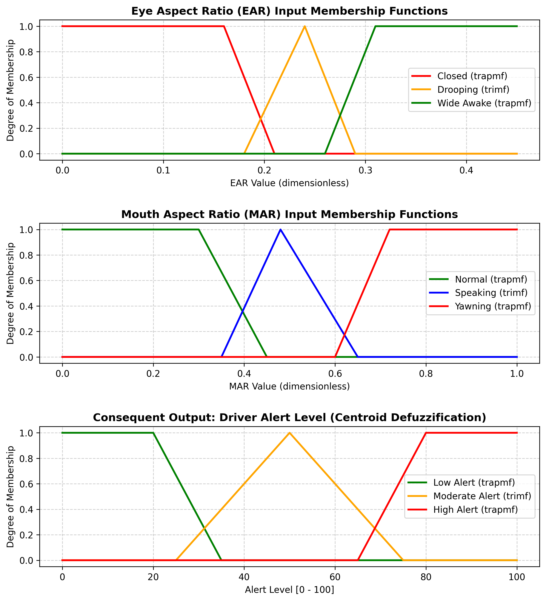
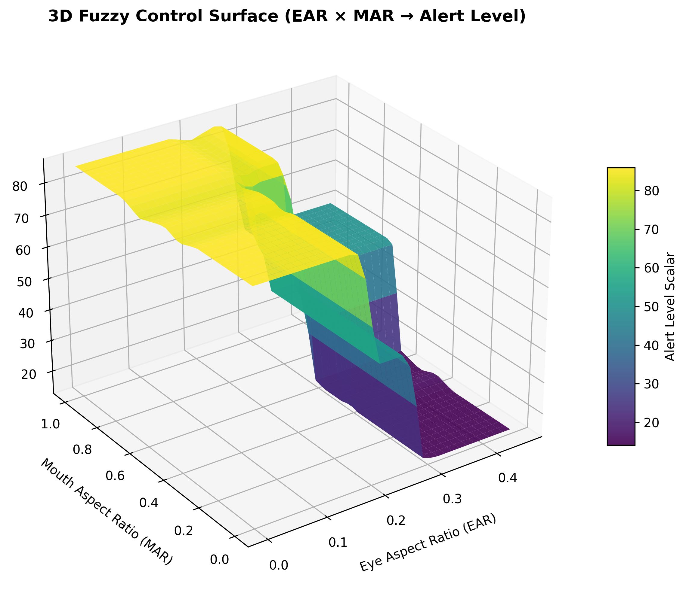

# 🚗 Driver Drowsiness Alert System

### EEE1004: Neural Networks and Fuzzy Systems — Course Project

A real-time **Advanced Driver Assistance System (ADAS)** that detects driver drowsiness using a cascade of deep neural facial landmark regression and **Mamdani Fuzzy Inference** with centroid defuzzification. Built to satisfy the algorithmic requirements of the EEE1004 syllabus across Units 1–5.

---

## 📋 Table of Contents

- [Problem Statement](#problem-statement)
- [Proposed Solution & Architecture](#proposed-solution--architecture)
- [EEE1004 Syllabus Mapping](#eee1004-syllabus-mapping)
- [Mathematical Formulations](#mathematical-formulations)
- [Fuzzy Membership Functions](#fuzzy-membership-functions)
- [Fuzzy Rule Base](#fuzzy-rule-base)
- [Project Structure](#project-structure)
- [Installation & Setup](#installation--setup)
- [How to Run](#how-to-run)
- [System Screenshots & Plots](#system-screenshots--plots)
- [Tech Stack](#tech-stack)
- [Future Scope](#future-scope)

---

## Problem Statement

Driver fatigue and microsleep (involuntary sleep episodes lasting 1–3 seconds) are responsible for approximately **20–30% of severe road accidents** worldwide. Conventional drowsiness detection systems rely on rigid binary thresholds (e.g., `if EAR < 0.25 then ALERT`) which suffer from:

- **High false-positive rates** due to natural facial variation (eye shape, squinting, lighting).
- **No gradual warning**: Drowsiness is a continuous cognitive degradation, not a binary switch.
- **Poor adaptability**: A fixed threshold cannot generalize across different drivers.

### Why Fuzzy Logic?

Fuzzy logic replaces hard boundaries with **smooth, overlapping membership functions** that model the inherent uncertainty and gradation of human fatigue. Instead of a binary 0/1, the system computes a **continuous Alert Level scalar (0 to 100)** that transitions smoothly through Safe → Caution → Critical states, enabling:

- Proportional early warnings before dangerous microsleep events.
- Tolerance to natural facial variation via overlapping fuzzy set boundaries.
- Full explainability — every alert can be traced back to specific linguistic rules.

---

## Proposed Solution & Architecture

```
┌─────────────────────────────────────────────────────────────────────┐
│                    REAL-TIME PROCESSING PIPELINE                    │
│                                                                     │
│   ┌─────────┐    ┌────────────┐    ┌──────────┐    ┌────────────┐  │
│   │ Webcam  │───▶│ MediaPipe  │───▶│ Euclidean│───▶│  Mamdani   │  │
│   │ (BGR    │    │ Face Mesh  │    │ Distance │    │  Fuzzy     │  │
│   │ Frames) │    │ Deep CNN   │    │ Math     │    │  Inference │  │
│   └─────────┘    │ (468 3D    │    │ (EAR,MAR)│    │  System    │  │
│                  │ Landmarks) │    └──────────┘    │ (skfuzzy)  │  │
│                  └────────────┘                    └─────┬──────┘  │
│                                                          │         │
│                  ┌───────────────────────────────────────┘         │
│                  ▼                                                  │
│         ┌────────────────┐    ┌─────────────────────────┐          │
│         │   Centroid     │───▶│   ADAS Cockpit HUD     │          │
│         │ Defuzzification│    │   - Telemetry Card     │          │
│         │ (Alert: 0-100) │    │   - Color Gauge Bar    │          │
│         └────────────────┘    │   - Facial Contours    │          │
│                               │   - Audio Alarm        │          │
│                               └─────────────────────────┘          │
└─────────────────────────────────────────────────────────────────────┘
```

---

## EEE1004 Syllabus Mapping

| Unit | Topic from Handout | Implementation in This Project |
| :--- | :--- | :--- |
| **Unit 1** | Introduction & Fundamental Models of ANN; Biological neuron, models of ANN | MediaPipe Face Mesh uses a deep feed-forward convolutional neural network to regress 468 spatial facial landmark coordinates from RGB frames. |
| **Unit 2** | Feed Forward and Feedback Networks; Back propagation | The landmark regressor backbone is a multi-layer feed-forward CNN trained via backpropagation (coordinate regression loss). |
| **Unit 4** | Introduction of Fuzzy Systems; Classical sets and fuzzy sets, operations on fuzzy sets, membership functions, fuzzification, defuzzification | EAR and MAR are fuzzified using triangular (`trimf`) and trapezoidal (`trapmf`) membership functions. Centroid (Center of Gravity) defuzzification produces the continuous Alert Level. |
| **Unit 5** | Fuzzy Rule Based System and Applications; Formation of rules, aggregation, fuzzy inference system, fuzzy logic applications in control systems, image processing | A 3×3 Mamdani IF-THEN rule matrix connects facial telemetry to alert states. T-norm (Min) conjunction and S-norm (Max) aggregation produce the combined output fuzzy set. Applied to real-time image processing for driver safety control. |

### Course Outcomes (COs) Satisfied

| CO | Description | Evidence |
| :--- | :--- | :--- |
| **CO2** | Design applications of neural networks | Applied pre-trained deep CNN for real-time facial landmark coordinate regression. |
| **CO3** | Apply the concepts and rule-based fuzzy logic system | Formulated linguistic variables, membership functions, and a 9-rule Mamdani knowledge base. |
| **CO4** | Design and implementation of fuzzy logic controllers in engineering areas | Built a complete closed-loop ADAS fuzzy controller with centroid defuzzification and live graphical telemetry. |

---

## Mathematical Formulations

### Eye Aspect Ratio (EAR)

Based on the Soukupová & Čech (2016) formulation using 6 landmark points per eye:

$$\text{EAR} = \frac{\|P_2 - P_6\|_2 + \|P_3 - P_5\|_2}{2 \cdot \|P_1 - P_4\|_2}$$

The binocular average is computed as:

$$\text{EAR}_{\text{avg}} = \frac{\text{EAR}_{\text{left}} + \text{EAR}_{\text{right}}}{2}$$

### Mouth Aspect Ratio (MAR)

Computed using 8 lip contour landmarks:

$$\text{MAR} = \frac{\|P_2 - P_8\|_2 + \|P_3 - P_7\|_2 + \|P_4 - P_6\|_2}{2 \cdot \|P_1 - P_5\|_2}$$

### Centroid Defuzzification (Center of Gravity)

The crisp output scalar is computed from the aggregated fuzzy output set:

$$z^* = \frac{\int z \cdot \mu_{\text{agg}}(z) \, dz}{\int \mu_{\text{agg}}(z) \, dz}$$

---

## Fuzzy Membership Functions

### Input 1: Eye Aspect Ratio (EAR)

Universe of Discourse: [0.00, 0.45]

| Linguistic Set | Type | Parameters |
| :--- | :--- | :--- |
| **Closed** | Trapezoidal | [0.00, 0.00, 0.16, 0.21] |
| **Drooping** | Triangular | [0.18, 0.24, 0.29] |
| **Wide Awake** | Trapezoidal | [0.26, 0.31, 0.45, 0.45] |

### Input 2: Mouth Aspect Ratio (MAR)

Universe of Discourse: [0.00, 1.00]

| Linguistic Set | Type | Parameters |
| :--- | :--- | :--- |
| **Normal** | Trapezoidal | [0.00, 0.00, 0.30, 0.45] |
| **Speaking** | Triangular | [0.35, 0.48, 0.65] |
| **Yawning** | Trapezoidal | [0.60, 0.72, 1.00, 1.00] |

### Output: Alert Level

Universe of Discourse: [0, 100], Defuzzification: Centroid (COG)

| Linguistic Set | Type | Parameters |
| :--- | :--- | :--- |
| **Low** | Trapezoidal | [0, 0, 20, 35] |
| **Moderate** | Triangular | [25, 50, 75] |
| **High** | Trapezoidal | [65, 80, 100, 100] |

---

## Fuzzy Rule Base

The 3×3 Mamdani IF-THEN knowledge base matrix:

| EAR \ MAR | **Normal** | **Speaking** | **Yawning** |
| :--- | :--- | :--- | :--- |
| **Wide Awake** | Low | Low | Moderate |
| **Drooping** | Moderate | Moderate | High |
| **Closed** | High | High | High |

**Conjunction Operator (AND)**: Minimum (T-norm)
**Aggregation Operator**: Maximum (S-norm)
**Implication Method**: Mamdani (Min Clipping)

---

## Project Structure

```
nnproject/
│
├── config/
│   ├── __init__.py
│   └── settings.py              # Camera, landmark indices, fuzzy MF coordinates
│
├── fis/                         # Fuzzy Inference System [Unit 4 & 5]
│   ├── __init__.py
│   ├── membership.py            # Antecedent/Consequent MF definitions
│   ├── rules.py                 # 9-rule Mamdani IF-THEN knowledge base
│   └── controller.py            # ControlSystem simulator & centroid defuzzifier
│
├── vision/                      # Computer Vision Pipeline [Unit 1 & 2]
│   ├── __init__.py
│   ├── telemetry.py             # Vectorized NumPy EAR & MAR computation
│   └── landmark_tracker.py      # MediaPipe Face Mesh neural tracker
│
├── utils/
│   ├── __init__.py
│   └── visualizer.py            # Real-time ADAS cockpit HUD renderer
│
├── scripts/
│   └── plot_fis.py              # Generates MF curves & 3D control surface for report
│
├── plots/
│   ├── membership_functions.png # 2D membership function visualization
│   └── fuzzy_control_surface_3d.png  # 3D EAR × MAR → Alert surface
│
├── main.py                      # Application entry point
└── requirements.txt             # Python package dependencies
```

---

## Installation & Setup

### Prerequisites
- **Python 3.10+** (64-bit) on Windows
- A working webcam (internal or external USB)
- VS Code (recommended IDE)

### Steps

1. **Clone or download this project** to your local machine.

2. **Install dependencies:**
   ```powershell
   cd c:\Users\HP\Desktop\nnproject
   pip install -r requirements.txt
   ```

3. **Generate report visualizations (optional):**
   ```powershell
   python scripts/plot_fis.py
   ```
   This saves publication-quality plots to the `plots/` directory.

---

## How to Run

```powershell
python main.py
```

| Key | Action |
| :--- | :--- |
| `q` | Quit and close the application |
| `ESC` | Quit and close the application |

### Live Demonstration Scenarios

| Test Case | Action | Expected Alert Level |
| :--- | :--- | :--- |
| **Nominal Driving** | Look at camera normally, mouth closed | 10–25% (Green / Safe) |
| **Yawning** | Open mouth wide for 2–3 seconds | 45–65% (Yellow / Caution) |
| **Microsleep** | Close eyes for 2+ seconds | 75–95% (Red / Critical + Audio Alarm) |

---

## System Screenshots & Plots

### Membership Function Curves


### 3D Fuzzy Control Surface


---

## Tech Stack

| Component | Technology | Purpose |
| :--- | :--- | :--- |
| Facial Landmark Detection | MediaPipe Face Mesh | 468-point 3D neural coordinate regression |
| Numerical Processing | NumPy | Vectorized Euclidean distance computation |
| Fuzzy Inference Engine | scikit-fuzzy | Mamdani FIS with centroid defuzzification |
| Video Capture & HUD | OpenCV | Real-time video stream and cockpit overlay |
| Report Visualizations | Matplotlib | 2D membership curves and 3D control surface |
| Audio Alerts | winsound | Windows-native acoustic alarm (2500 Hz pulse) |

---

## Future Scope

| Enhancement | Description |
| :--- | :--- |
| **ANFIS (Adaptive Neuro-Fuzzy Inference System)** | Use neural backpropagation to automatically tune membership function shapes from a pre-recorded drowsiness dataset, replacing manual parameter specification. |
| **Head Pose Estimation** | Add a third fuzzy input (head tilt angle) to detect nodding and looking away from the road. |
| **Temporal LSTM Integration** | Feed a sliding window of EAR/MAR sequences into an LSTM recurrent network to detect gradual fatigue trends over time. |
| **Edge Deployment** | Port the system to a Raspberry Pi or NVIDIA Jetson Nano for embedded vehicle installation. |
| **Driver Calibration Mode** | Add a 10-second startup calibration phase to personalize baseline EAR and MAR thresholds per driver. |

---

## References

1. Soukupová, T. & Čech, J. (2016). *Real-Time Eye Blink Detection using Facial Landmarks*. 21st Computer Vision Winter Workshop.
2. Zadeh, L. A. (1965). *Fuzzy Sets*. Information and Control, 8(3), 338–353.
3. Mamdani, E. H. & Assilian, S. (1975). *An experiment in linguistic synthesis with a fuzzy logic controller*. International Journal of Man-Machine Studies, 7(1), 1–13.
4. Google MediaPipe. *Face Mesh: Real-time Face Geometry*. [https://google.github.io/mediapipe/solutions/face_mesh.html](https://google.github.io/mediapipe/solutions/face_mesh.html)

---

> **Course**: EEE1004 — Neural Networks and Fuzzy Systems
> **Credits**: 4 (L-T-P: 3-1-0)
